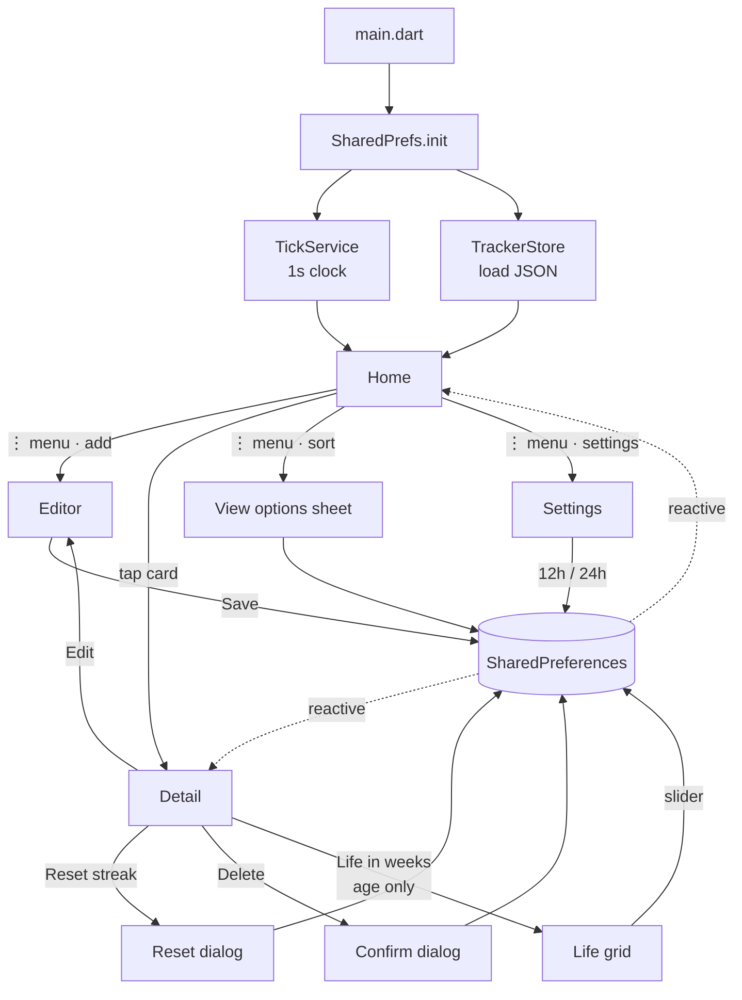
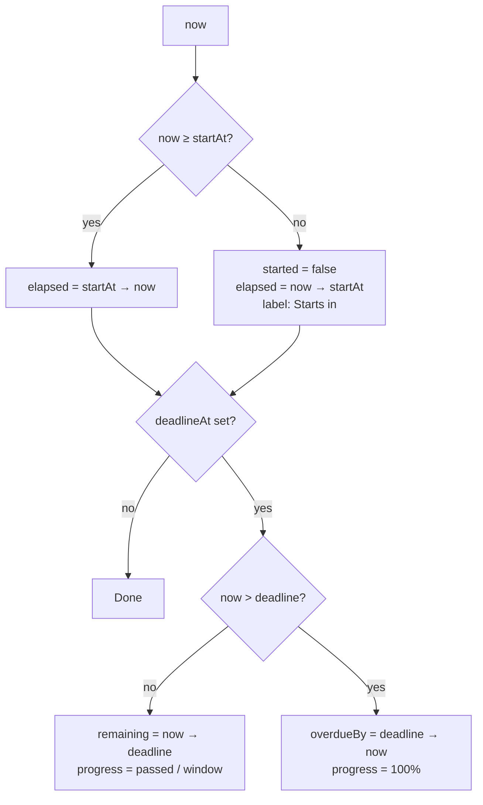
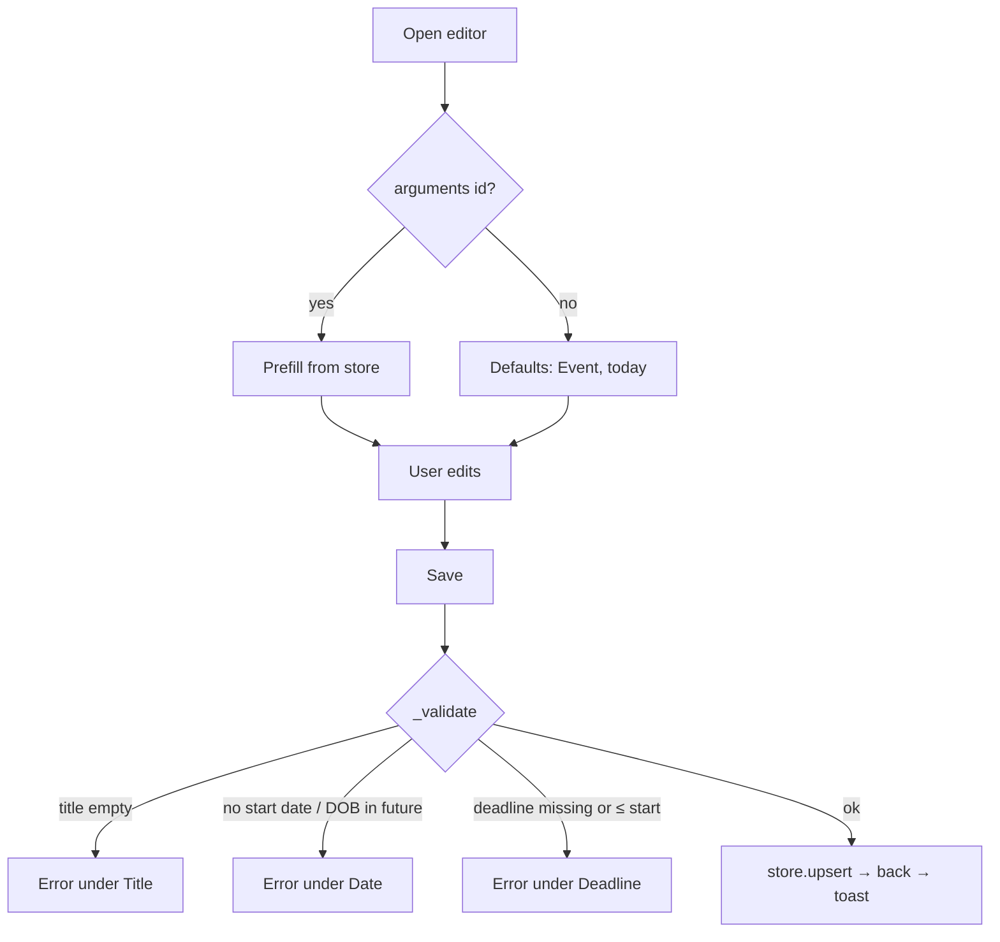
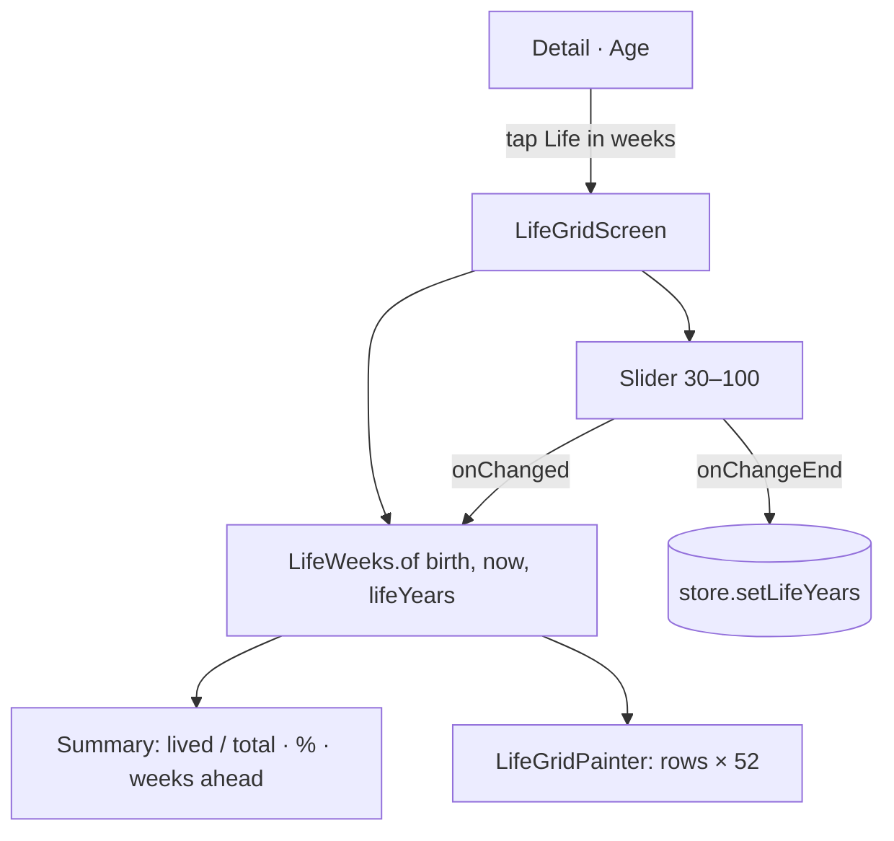
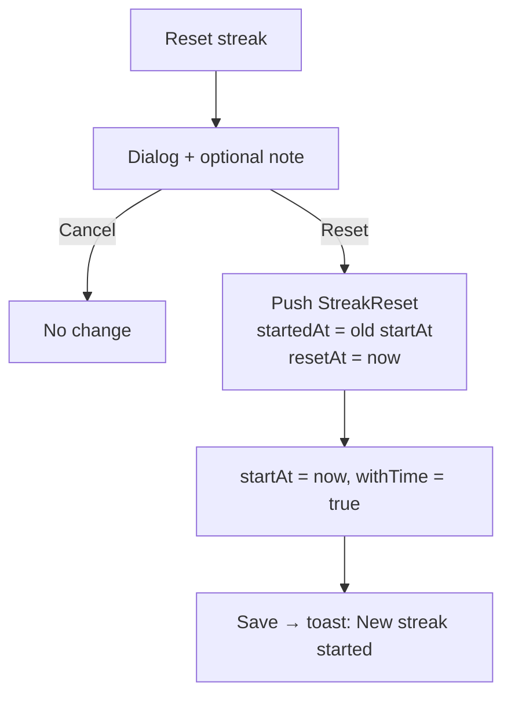
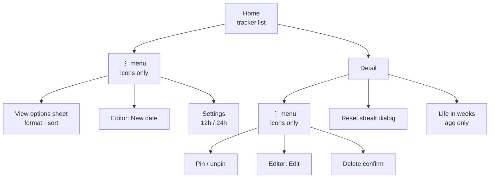

# App Flow

End-to-end user and data flow for Lifetime. Everything is local: there is no backend, login or network.

## High-level



## Launch / init

| Step | Where |
|---|---|
| Init SharedPreferences | `lib/main.dart:16` |
| Register `TickService` (permanent) | `lib/main.dart:17` → `lib/service/tick_service.dart:14` |
| Register `TrackerStore` and load trackers, format and sort | `lib/main.dart:18` → `lib/service/tracker_store.dart:34` |
| Optional demo seed (`--dart-define=SEED_DEMO=true`) | `lib/service/tracker_store.dart:50` |
| Dark system bars, portrait lock | `lib/main.dart:20` |
| `GetMaterialApp` → `AppRoutes.homePath`, fade transitions (off with reduce-motion) | `lib/main.dart:38` |

Native launch screens use `#0A0A0A` (`android/app/src/main/res/values/colors.xml`, `ios/Runner/Base.lproj/LaunchScreen.storyboard`), so there is no white flash.

## Live time model

The app has one clock. `TickService.now` updates every second. Screens read it inside `Obx`, and for each tracker they compute a fresh `TrackerMetrics.of(tracker, now)` (`lib/core/tracker_metrics.dart:35`). Metrics are pure and cheap, and nothing time-related is stored.



`TimeSpan.between` (`lib/core/time_span.dart:36`) does calendar-correct Y/M/D math on wall-clock values, so DST changes never shift results. Month ends clamp: Jan 31 + 1 month = Feb 28/29.

## Home

`lib/app/home/page/home_screen.dart`

- App bar: a **⋮** button opens an icon-only menu with **add date**, **sort & display** and **settings** (shared `AppIconMenu`, `lib/widgets/app_icon_menu.dart`). There is no floating button.
- Empty state: icon, explanation, and one **Add your first date** button (kept so a new user isn't left looking for the menu).
- List: `TrackerCard` per tracker (`lib/app/home/widget/tracker_card.dart`):
  - Type icon, title, pin marker
  - Overline: `SINCE <date>` / `AGE` / `CURRENT STREAK` / `STARTS IN`
  - Headline in the chosen `DisplayFormat`, plus a ticking `hh:mm:ss`
  - Footnote: `Turns N in …` (age), `Best …` (habit with history)
  - Deadline line: `Xd left` or **⚠ Overdue by …** and `% passed` on the left, progress pie (`lib/widgets/app_pie.dart`) on the right
- Sorting (`lib/service/tracker_store.dart:104`): pinned first, then the selected `SortMode`.
- **View options** sheet (`lib/app/home/widget/view_options_sheet.dart`): display format (`Y M D` / `Days` / `Hours`) and sort. Both are persisted.

## Add / Edit

`lib/app/editor/` (full-screen dialog route). Pass a tracker id as `Get.arguments` to edit.



- Type segmented control changes labels: *Date* / *Date of birth* / *Streak started*. **Age** hides the deadline, since the birthday countdown is automatic.
- Deadline has two modes: **On a date** (date + optional time picker) or **After a period** (Years / Months / Days fields). Period mode computes `deadlineAt = DeadlineOffset.addTo(startAt)` with calendar math (29 Feb clamps to 28 Feb), shows a live "Ends on …" preview, and saves `deadlineOffset` so the deadline follows the start date on edit (`lib/data/model/tracker.dart`, `lib/app/editor/controller/editor_controller.dart`).
- **Include time** switch adds time pickers. Without it, dates are midnight local time.
- Validation: `lib/app/editor/controller/editor_controller.dart:135`. Save: `:159`.
- Errors follow the design system: icon + "Error: …" text + white 1.5px border. No red is used.

## Detail

`lib/app/detail/page/detail_screen.dart`, sections in `lib/app/detail/widget/detail_sections.dart`.

1. Header: type, title, start date, big headline, and a ticking clock
2. **Breakdown**: years, months, days, hours, minutes, seconds
3. **Deadline** (if set): time left or overdue (`+` prefix + warning icon), progress pie on the right (white = elapsed, grey = remaining), start date · `%` · deadline below
4. **Birthday** (age): next birthday + weekday, `Turning N in`, `Born on a <weekday>`, plus the **Life in weeks** card
5. **Streak** (habit): best streak, attempts, **Reset streak**, history list
6. **In total**: months, weeks, days, hours, minutes, seconds
7. Note

App bar: a single **⋮** button opens an icon-only menu with **pin/unpin**, **edit** and **delete**. Each icon has a semantic label for screen readers, and delete still asks for confirmation (`AppIconMenu`, the same widget Home uses). The screen re-reads the store reactively, so edits appear right away.

## Settings

`lib/app/settings/` opens from the Home ⋮ menu.

| Setting | Values | Stored | Applies to |
|---|---|---|---|
| Time format | **12-hour** (default) / **24-hour** | `SharedPrefs.use24h` via `SettingsService` (`lib/service/settings_service.dart`) | Start and deadline times on cards and the Detail header (`formatTime(use24h:)` in `lib/core/formatters.dart`), the editor's time fields, and the time-picker dial |

The time pickers and `TimeOfDay.format` follow the setting through an app-wide `MediaQuery(alwaysUse24HourFormat:)` wrapper in `GetMaterialApp.builder` (`lib/main.dart`). Elapsed clocks such as `05:12:09` are durations, so they don't change.

## Life in weeks (Age trackers)

Based on the "Your Life in Weeks" idea: **one row per year of age, 52 boxes per row**.

- Entry: the **Life in weeks** card in the Detail screen's Birthday section shows `lived of total weeks · %`, and tapping it opens `lib/app/life_grid/page/life_grid_screen.dart`.
- Math: `LifeWeeks.of(birth, now, lifeYears)` (`lib/core/life_weeks.dart`)
  - `ageYears` = completed years. `weekOfYear` = days since the last birthday ÷ 7, capped at box 52 (which absorbs the 1–2 extra days each year)
  - `lived = ageYears × 52 + weekOfYear`, `total = lifeYears × 52`
  - Outliving the expectancy adds rows (`rows = max(lifeYears, ageYears + 1)`) and changes the summary to "every week is a bonus".
- Drawing: `LifeGridPainter` (`lib/app/life_grid/widget/life_grid_painter.dart`) batches all boxes into two paths (lived = `text.primary`, ahead = `bg.highest`) plus a white outline for this week. Decade labels sit in a 20px gutter, with an extra gap every 10 rows.
- **Life expectancy**: stored per tracker in `Tracker.lifeYears`. The default is **60** and the slider goes from **30 to 100**. The grid updates live while dragging, and the value is saved on release (`TrackerStore.setLifeYears`).
- The grid doesn't tick (it only changes once a week), so it's computed once per build.



## Habit reset



Code: `lib/app/detail/controller/detail_controller.dart:44` → `lib/service/tracker_store.dart:154`. The best streak is the maximum of all history lengths and the current streak (`lib/core/tracker_metrics.dart:75`).

## Delete

`lib/app/detail/controller/detail_controller.dart:31`: confirm dialog → pop the detail screen → `store.delete(id)` → toast.

## API endpoints

None. The app is local-only, with no network calls.

| Method | Endpoint | Purpose |
|---|---|---|
| — | — | — |

## Persistence & services

| Item | Kind | Stored as | Where |
|---|---|---|---|
| `SharedPrefs` | singleton wrapper | — | `lib/service/shared_pref.dart` |
| Trackers | `SharedPrefs.trackers` | JSON array of `Tracker` (with `resets`) | `lib/service/tracker_store.dart:98` |
| Display format | `SharedPrefs.displayFormat` | enum name | `lib/service/tracker_store.dart` |
| Sort mode | `SharedPrefs.sortMode` | enum name | `lib/service/tracker_store.dart` |
| 12/24-hour clock | `SharedPrefs.use24h` | bool | `lib/service/settings_service.dart` |
| `SettingsService` | `GetxService` (permanent) | reactive `use24h` | `lib/service/settings_service.dart` |
| `TickService` | `GetxService` (permanent) | in-memory `now`, 1s timer | `lib/service/tick_service.dart` |
| `TrackerStore` | `GetxService` (permanent) | reactive `items`, `format`, `sort` | `lib/service/tracker_store.dart` |

### Tracker JSON

```json
{
  "id": "1760251234567890",
  "title": "No sugar",
  "type": "habit",
  "startAt": "2026-10-01T00:00:00.000",
  "deadlineAt": "2026-12-31T00:00:00.000",
  "deadlineOffset": { "years": 0, "months": 0, "days": 0 },   // only when set by period
  "withTime": false,
  "pinned": true,
  "note": "optional",
  "createdAt": "2026-10-01T09:12:00.000",
  "lifeYears": 60,
  "resets": [
    { "startedAt": "2026-08-01T00:00:00.000", "resetAt": "2026-10-01T00:00:00.000", "note": "Cake" }
  ]
}
```

## Sitemap


